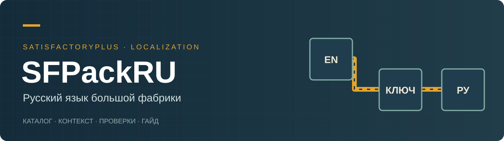

<div align="center">



# SFPackRU

**Literary Russian localization for a pinned SatisfactoryPlus modpack**

[Русский](README.md) · English

</div>

A reviewed localization catalog, original Planner translation module sources, dated validation evidence and a detailed Russian progression guide for a 49-module SatisfactoryPlus installation.

**Work in progress.** Catalog version 2.2.0 describes a local package tested on **October 4, 2026**. This repository was prepared on October 31. It is not a complete, installable public release. Native Planner hooks and additional BoomBox Plus FString messages have not been compiled or tested inside Unreal.

## Included

- 8,286 reviewed unique sources and 12,283 active localization keys; 12,099 changed translations.
- Context overrides and documented key conflicts.
- 798 unique Planner sources / 820 rows, an original C++ translation core and standalone tests.
- A self-contained, 15-section Russian guide: open `docs/guide-ru.html` locally.
- A pinned mod manifest and sanitized historical validation summaries.

## Inspect and build catalogs

Python 3.10+; no external Python dependencies:

```sh
python tools/catalog.py unpack
python tools/catalog.py check
python tools/catalog.py build-locres
```

Commands write to `build/`, never to the game. The catalog build does not recreate the cooked Blueprint overlay or compile the Unreal module. The repository does not redistribute game assets, SDKs, third-party binaries, saves or personal configuration.

## Compatibility

Pinned Windows Steam build CL 502094, SML 3.12.0, SatisfactoryPlus 2026.3.489, UE 5.6.1-CSS, Wwise SDK 2023.1.14.8770 and integration 2023.1.14.3555. Planner hooks are restricted to the recorded 1.7.1 DLL hash. Compatibility with newer game/mod releases is not established.

[Status](docs/STATUS.md) · [Architecture](docs/ARCHITECTURE.md) · [Native work](docs/NATIVE.md) · [Roadmap](ROADMAP.md) · [Contributing](CONTRIBUTING.md)

MIT covers original project code and tools only. Source strings and derivative translations retain applicable upstream rights. See [NOTICE.md](NOTICE.md). Unofficial community project by Igor Kramar, developed with Codex assistance; not affiliated with Coffee Stain Studios.
