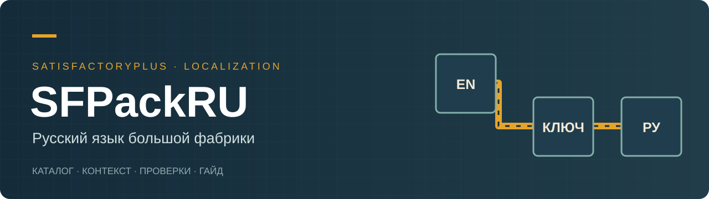

<div align="center">



# SFPackRU

**Литературная русская локализация сборки SatisfactoryPlus**

Русский · [English](README.en.md)


[Гайд](docs/guide-ru.html) · [Состав сборки](docs/MODS.md) · [Состояние](docs/STATUS.md) · [Архитектура](docs/ARCHITECTURE.md) · [План](ROADMAP.md)

</div>

Перевод недостающих текстов модов в одной согласованной редакции: названия машин, рецепты, настройки, подсказки, строительные инструменты и сообщения интерфейса. Вместе с ним — подробный маршрут развития фабрики, редакционная память и исходники дополнительного перевода Planner.

**Проект не завершён.** Версия **2.2.0** обозначает исторический локальный пакет, проверенный **4 октября 2026 года**, а не готовность всей локализации. Публичный репозиторий оформлен 31 октября. Нативные компоненты Planner и дополнительные сообщения BoomBox Plus пока не скомпилированы и не установлены. [Точные границы результата](docs/STATUS.md).

## Что уже есть

| Часть | Подтверждённый результат |
| --- | --- |
| Основной каталог | 8 286 уникальных вычитанных источников; 12 283 активных ключа; 12 099 изменённых текстов |
| Контекст | 11 отдельных решений для неоднозначных подписей; конфликты ключей учтены |
| Объекты модов | 4 044 текстовых свойства у 2 776 объектов через KDataForge |
| Blueprint | 51 вхождение в 26 ресурсах, 39 новых ключей; локальный пакет проверен загрузкой карты |
| Native FText | 102 ключа BoomBox Plus и 373 дополнительных ключа Smart!/Circuitry |
| Planner | 798 уникальных источников / 820 записей; исходники и отдельные тесты алгоритма |
| Руководство | 15 разделов: от первой руды до позднего производства, диагностика и обслуживание |

184 записи намеренно сохранены: имена модов, обозначения и идентификаторы. Вычитка каталога не означает переписывание всех существовавших русских переводов или визуальную проверку каждого экрана.

## Начать знакомство

1. Откройте [состояние проекта](docs/STATUS.md) и [матрицу совместимости](docs/COMPATIBILITY.md).
2. Скачайте репозиторий. Откройте `docs/guide-ru.html` локально в браузере — это автономный документ.
3. Распакуйте редактируемые данные и проверьте каталог:

```sh
python tools/catalog.py unpack
python tools/catalog.py check
python tools/catalog.py build-locres
```

Нужен Python 3.10+; внешних Python-зависимостей нет. Результаты появятся в `build/`. Команды ничего не устанавливают в игру. `build-locres` воспроизводит двоичные словари; он не собирает Blueprint-контейнер или Unreal-модуль.

**Установка всей сборки из этого репозитория пока не предусмотрена.** Здесь опубликованы текстовые данные, собственные исходники, гайд и обезличенные отчёты. Игровые архивы, SDK, DLL сторонних модов, личные настройки и сохранения не включены. Для полноценной новой установки нужны оригинальные моды зафиксированных версий и отдельная сборка недостающих компонентов.

## Контрольная среда

| Компонент | Версия |
| --- | --- |
| Satisfactory / Windows Steam | CL 502094 |
| SatisfactoryPlus | 2026.3.489 |
| Satisfactory Mod Loader | 3.12.0 |
| Unreal Engine CSS | 5.6.1-CSS, release 5.6.1-css-83 |
| Wwise SDK / integration | 2023.1.14.8770 / 2023.1.14.3555 |
| Pioneer Production Planner | 1.7.1, точный хеш DLL зафиксирован |
| BoomBox Plus | 1.3.7 |

Это зафиксированный срез, а не обещание совместимости с текущими обновлениями. Сборка SF+ в этом срезе рассчитана на одиночную игру. Все 49 модулей и ссылки на оригинальные загрузки находятся в [lock-файле](data/mods.lock.json).

## Как устроен репозиторий

```text
data/                    редактируемые каталоги, контекст и версии модов
docs/                    гайд, архитектура, совместимость и ограничения
evidence/                обезличенные результаты проверок с датами
native/SFPackRURuntime/   исходники экспериментального модуля Planner
tools/                   распаковка, валидация и сборка locres
```

[Нативный перевод](docs/NATIVE.md) объясняет, почему `.locres` недостаточно для некоторых сообщений. [CONTRIBUTING.md](CONTRIBUTING.md) описывает вычитку и сообщения об ошибках.

[Досье проекта в Notion](https://www.notion.so/40a99aa2eb7b81588b34c1ae911bae6a) — история, результаты и следующий проверяемый шаг (доступ зависит от прав в рабочем пространстве).

## Проверки и продолжение

Исторические проверки: 65 YAML-документов без ошибок линтера, 73 установленных файла сверены по хешам, контрольная карта загрузилась, шесть исходных сохранений не изменились. Девять известных ошибок KDataForge сохранены в отчёте как ограничение исходной сборки. Это не полный плейтест.

Следующий технический этап — завершить интеграцию Wwise, собрать нативные модули, проверить их в отдельном новом мире и визуально пройти интерфейс. Статусы и критерии приёмки: [ROADMAP.md](ROADMAP.md).

## Авторство и права

Проект Игоря Крамаря, подготовлен с помощью Codex. Это неофициальная работа сообщества, не связанная с Coffee Stain Studios. [MIT](LICENSE) распространяется на оригинальный код и инструменты этого проекта; права на игру, сторонние моды, исходные тексты и производные переводы сохраняются за соответствующими правообладателями. [Источники и благодарности](NOTICE.md).
