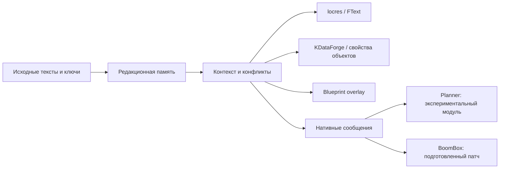

# Устройство локализации

Один мод может одновременно использовать несколько способов вывода текста. Поэтому общий словарь дополняется отдельными слоями.

## Каталог

Идентичность FText задаётся namespace, key и хешем исходного текста. Несовпадающие источники с одинаковыми ключами требуют отдельного решения: актуальный ресурс заменяет устаревшую запись либо получает новый ключ `SFPackRU.Code`. Нельзя выбирать перевод только по английской подписи.

`data/translations.json.gz` сохраняет редакционный каталог с историческим признаком `deployed`. Число строк файла может отличаться от 12 283: варианты конфликтов сохранены для аудита. `tools/catalog.py` собирает активные уникальные идентичности и проверяет чтение записанного locres.

## Текстовые свойства объектов

KDataForge меняет текстовые поля CDO, сохраняя классы и рецептурные идентификаторы. В локальной поставке затронуты 4 044 поля у 2 776 объектов. Собственные словари загружаются после локализации модов.

## Blueprint

Обычная повторная упаковка через `retoc to-zen` в исследованном сценарии нарушала импорты и приводила к `Struct type unknown`. Рабочий локальный контейнер сохраняет оригинальные импорты и зависимости Zen, меняя экспортные данные и необходимые смещения. Отчёт включён; сами cooked-ресурсы не публикуются.

## Нативные строки

Часть `FString` не обращается к locres. Для BoomBox подготовлены изменения литералов исходного кода; для закрытого интерфейса Planner — отдельный собственный модуль с проверкой точного хеша DLL и байтов входа в две функции локализации. Подробнее: [NATIVE.md](NATIVE.md).

## Проверка

Редактура → сохранность параметров и чисел → проверка конфликтов → чтение собранных словарей → линтер → загрузка отдельного тестового мира → визуальная приёмка. Последний этап и проверка нативного модуля остаются открытыми.
